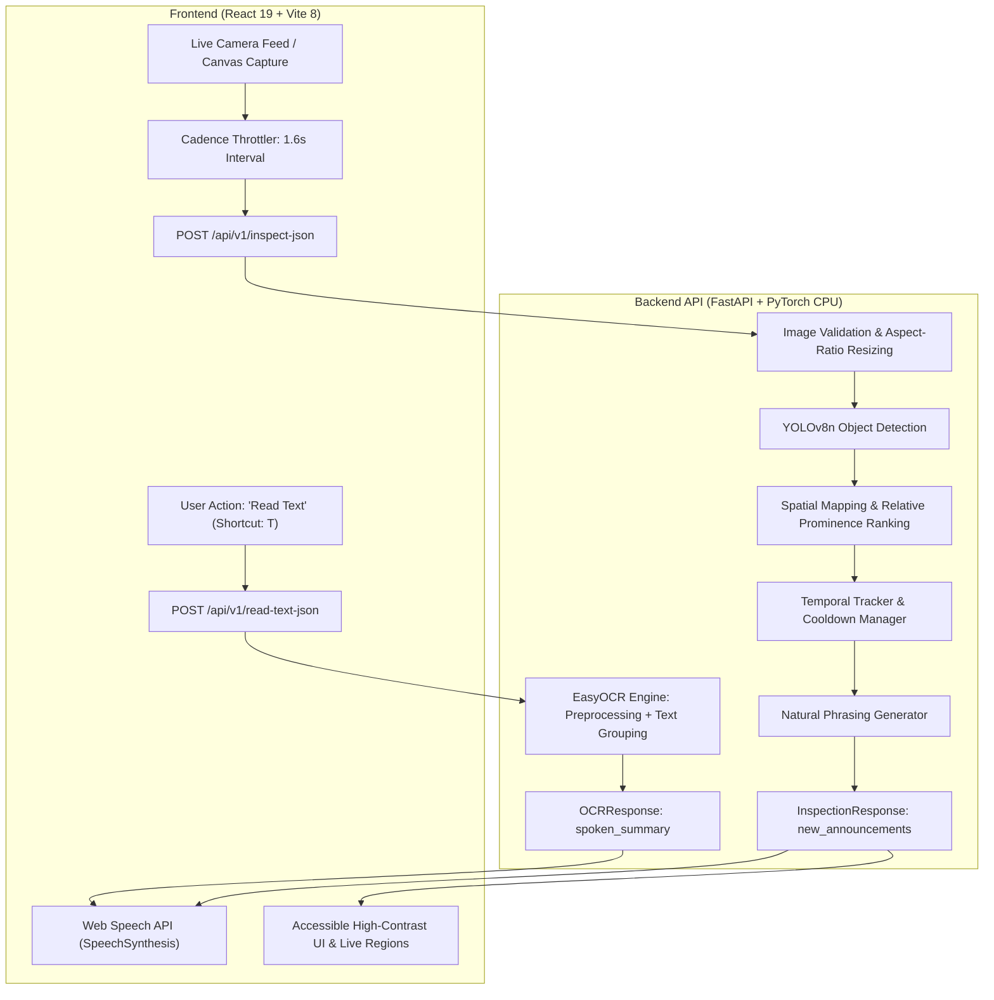

# VisionMate — AI Visual Assistant for Accessibility

[](https://www.python.org/)
[](https://fastapi.tiangolo.com/)
[](https://react.dev/)
[](https://github.com/ultralytics/ultralytics)
[](https://github.com/JaidedAI/EasyOCR)
[](backend/tests/)

**VisionMate** is an accessible assistive perception prototype engineered for individuals who are blind or have low vision. Operating entirely on standard consumer hardware (CPU-optimized, no dedicated GPU required), VisionMate transforms camera video streams into concise, prioritized, and non-overwhelming spatial auditory descriptions.

> ⚠️ **Safety & Assistive Invariant:**
> VisionMate is an **assistive perception prototype**, NOT a certified primary mobility or collision-avoidance device. It is designed to be **honest about uncertainty**—it never invents clear paths, hallucinates distance metrics, or declares an environment "safe". Uncalibrated monocular cameras estimate **relative visual prominence** (prominent/near, mid-range, distant) rather than unverified metric distances.

---

## Architecture Pipeline



---

## Key Features

### 1. Spatial Orientation & Relative Prominence
- **3-Zone Horizontal Spatial Partitioning:**
  - `Left`: $x_c < 0.35$
  - `Center`: $0.35 \le x_c \le 0.65$
  - `Right`: $x_c > 0.65$
- **Bounding Box Area Prominence Heuristic:**
  - `Prominent (Near)`: Area Ratio $\ge 15\%$ of frame
  - `Mid-range`: Area Ratio $4\% \dots 14.9\%$
  - `Distant`: Area Ratio $< 4\%$

### 2. Temporal Tracking & Announcement Cooldown
To prevent cognitive fatigue and repetitive noise:
- Multi-frame object persistence via **Intersection-over-Union (IoU)** tracking.
- An object is only announced aloud when one of 4 conditions occurs:
  1. **New Object Entry**: First time detected in scene.
  2. **Prominence Escalation**: Moving closer (e.g. transitioning from mid-range to prominent).
  3. **Zone Boundary Shift**: Object crosses horizontal zone (e.g. center $\to$ left).
  4. **Cooldown Expiration**: Configurable periodic reminder (default 5.0 seconds).

### 3. On-Demand OCR (Avoids Cognitive Overload)
- Continuous OCR during live navigation creates overwhelming auditory clutter.
- VisionMate activates **EasyOCR** *strictly on user demand* (tactile UI button or keyboard shortcut `T`).
- Clusters fragmented bounding boxes into coherent reading lines and filters low-confidence characters.

### 4. Accessible & Intuitive React UI
- **WCAG AAA Compliance:** High-contrast palette (`#0a0b14` dark theme, `#6c63ff` primary, `#00d4aa` secondary, `#ffa940` warning, `#4cc9f0` info).
- **Tactile Keyboard Shortcuts:**
  - `[Space]` — Pause / Resume continuous perception loop
  - `[R]` — Repeat last spoken announcement
  - `[T]` — Read text in view (OCR)
  - `[I]` — Single frame inspection
  - `[M]` — Toggle audio mute
- **ARIA Live Regions:** Screen-reader assertive alerts and polite announcements.
- **Hardware Agnostic Fallback:** Includes sample image upload for environments without physical webcams.
- **Perception Telemetry:** Displays roundtrip network latency, YOLO inference time, spatial prioritizer runtime, and FPS capacity.

---

## Project Structure

```text
VisionMate/
├── backend/
│   ├── app/
│   │   ├── config.py             # Settings, thresholds, and model weights path
│   │   ├── main.py               # FastAPI application setup & CORS
│   │   ├── routes/
│   │   │   ├── health.py         # Liveness & system diagnostics
│   │   │   ├── inspect.py        # Object detection & temporal tracking endpoints
│   │   │   └── read_text.py      # On-demand EasyOCR endpoints
│   │   ├── schemas/              # Strict Pydantic contracts
│   │   │   ├── detection.py      # DetectionItem, BoundingBox, SpatialPosition
│   │   │   ├── inspection.py     # InspectionRequest, InspectionResponse, SummaryMetrics
│   │   │   └── ocr.py            # OCRRequest, OCRResponse, TextBlock
│   │   └── vision/               # Modular Computer Vision services
│   │       ├── detector.py       # Thread-safe YOLOv8 wrapper & warmup
│   │       ├── image_processor.py# Image validation, decoding, aspect-ratio scaling
│   │       ├── prioritizer.py    # Spatial mapping, hazard sorting, natural phrasing
│   │       ├── tracker.py        # Multi-frame IoU tracking & cooldown manager
│   │       └── ocr.py            # EasyOCR singleton & text summarization
│   ├── tests/                    # 40 comprehensive unit & integration tests
│   │   ├── test_api_routes.py
│   │   ├── test_ocr.py
│   │   ├── test_tracker.py
│   │   └── test_vision_core.py
│   ├── demo_cv.py                # Standalone Phase 1 CV verification script
│   └── yolov8n.pt                # YOLOv8 nano model weights
├── frontend/
│   ├── public/
│   ├── src/
│   │   ├── components/           # Accessible, modular UI components
│   │   │   ├── CameraPreview.jsx
│   │   │   ├── CameraStatus.jsx
│   │   │   ├── ControlPanel.jsx
│   │   │   ├── DetectionOverlay.jsx
│   │   │   ├── ErrorMessage.jsx
│   │   │   ├── Header.jsx
│   │   │   ├── MetricsCard.jsx
│   │   │   ├── ReadTextButton.jsx
│   │   │   └── SpeechBanner.jsx
│   │   ├── hooks/
│   │   │   ├── useCamera.js      # MediaDevices video stream & canvas capture
│   │   │   └── useSpeech.js      # SpeechSynthesis controls (repeat, mute, pause)
│   │   ├── services/
│   │   │   └── visionmateApi.js  # Async fetch client for backend endpoints
│   │   ├── styles/
│   │   │   └── components.css    # High-contrast accessible component styles
│   │   ├── App.css               # Dashboard layout & responsiveness
│   │   ├── App.jsx               # Perception loop coordinator
│   │   ├── index.css             # Design tokens, typography & animations
│   │   └── main.jsx
│   ├── index.html
│   ├── package.json
│   └── vite.config.js
└── pytest.ini
```

---

## API Endpoints Reference

| Method | Endpoint | Description |
| :--- | :--- | :--- |
| `GET` | `/api/v1/health` | System health check and model loading state |
| `GET` | `/api/v1/model-info` | Supported classes, thresholds, and architectural parameters |
| `POST` | `/api/v1/inspect` | Multipart image upload for object detection and tracking |
| `POST` | `/api/v1/inspect-json` | Base64 image payload for real-time frontend canvas frames |
| `POST` | `/api/v1/read-text` | Multipart image upload for on-demand EasyOCR |
| `POST` | `/api/v1/read-text-json` | Base64 image payload for on-demand EasyOCR |

Interactive Swagger documentation is available at **`http://localhost:8000/docs`**.

---

## Quickstart Guide

### 1. Prerequisites
- **Python**: 3.12+
- **Node.js**: v18+ and `npm`
- **Operating System**: Windows, macOS, or Linux

### 2. Backend Setup & Startup
```powershell
# From the project root
python -m pip install -r requirements.txt

# Start the FastAPI backend server
python -m uvicorn backend.app.main:app --host 0.0.0.0 --port 8000 --reload
```
Verify the backend is live at `http://localhost:8000/api/v1/health`.

### 3. Frontend Setup & Startup
```powershell
# Open a second terminal and navigate to frontend
cd frontend
npm install

# Start the Vite development server
npm run dev
```
Open your browser at **`http://localhost:5173/`**.

---

## Running Automated Tests

VisionMate includes a 40-test suite covering vision utilities, spatial prioritization, temporal tracking cooldowns, OCR parsing, and FastAPI HTTP route validation:

```powershell
# Run the full test suite
python -m pytest backend/tests/ -v

# Run only temporal tracker tests
python -m pytest backend/tests/test_tracker.py -v

# Run only OCR tests
python -m pytest backend/tests/test_ocr.py -v
```

---

## Accessibility & Safety Invariants

1. **Non-Intrusive Guidance:** Spatial perception is structured into succinct audio sentences rather than continuous chatter.
2. **Prioritization of Hazards:** Dynamic obstacles (vehicles, bicycles, pedestrians) and potential hazards (drop-offs, stairs) receive highest priority in speech queuing.
3. **Honesty About Physical Limits:** Without stereo cameras or lidar sensors, VisionMate reports visual area ratio categorization rather than arbitrary meter approximations.
4. **On-Demand Reading:** Text extraction is kept separate from obstacle awareness to preserve user focus and safety while in motion.
